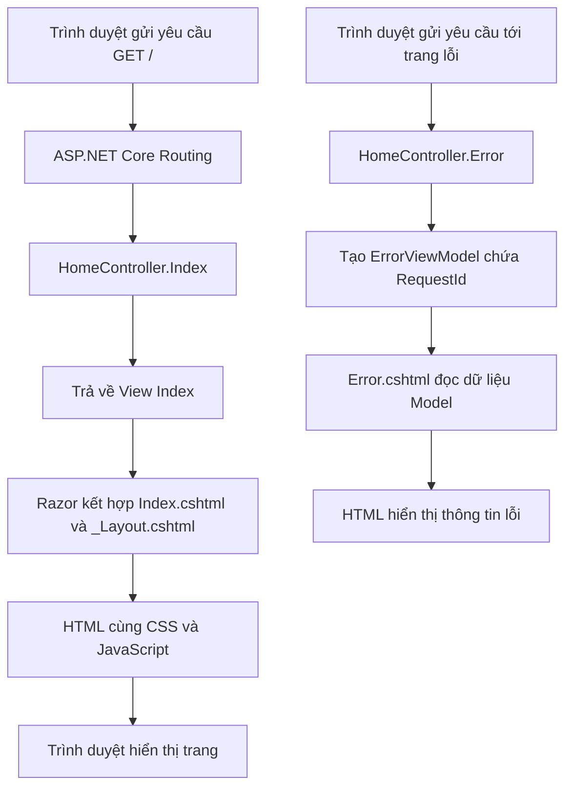
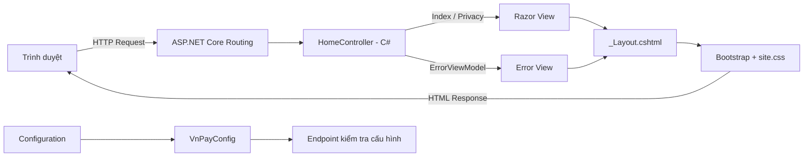

# GIỚI THIỆU ASP.NET CORE MVC, C#, RAZOR VIEWS VÀ BOOTSTRAP TRONG DỰ ÁN WEBSITE TÍCH HỢP VNPAY

> **Phạm vi tài liệu:** Phân tích kiến trúc và minh họa công nghệ dựa trên mã nguồn trong bản lưu trữ `VNPAY-ASP.NET-Core-MVC-main.zip` được cung cấp ngày 02/11/2026. Các trích đoạn mã trong tài liệu được lấy từ bản lưu trữ này; tài liệu không mặc nhiên phản ánh các nhánh hoặc Pull Request phát sinh sau thời điểm đó.

## 1. Tổng quan kiến trúc và công nghệ sử dụng

Dự án **VNPAY Payment Gateway Integration – ASP.NET Core MVC** được xây dựng phục vụ học phần *Phát triển ứng dụng Thương mại điện tử*, với định hướng phát triển website hỗ trợ các nghiệp vụ mua hàng và tích hợp môi trường thanh toán thử nghiệm VNPAY Sandbox. Về kiến trúc, ứng dụng lựa chọn ASP.NET Core MVC làm nền tảng xây dựng website, C# làm ngôn ngữ lập trình phía máy chủ, Razor Views để tạo giao diện động và Bootstrap kết hợp CSS để tổ chức giao diện thích ứng trên nhiều kích thước màn hình.

Kiến trúc Model–View–Controller (MVC) phân tách trách nhiệm tiếp nhận yêu cầu, quản lý dữ liệu và trình bày kết quả. Controller tiếp nhận yêu cầu HTTP và quyết định phản hồi; Model biểu diễn dữ liệu ứng dụng; View đảm nhiệm việc hiển thị dữ liệu và giao diện. Theo tài liệu của Microsoft, sự phân tách này hỗ trợ tổ chức, kiểm thử và bảo trì ứng dụng khi quy mô tăng lên [1].

### 1.1. Các thành phần công nghệ

| Công nghệ / thành phần | Vai trò kiến trúc | Bằng chứng trong bản mã nguồn khảo sát |
|---|---|---|
| ASP.NET Core MVC | Tiếp nhận, định tuyến yêu cầu và kết xuất giao diện theo mô hình MVC | `Program.cs`, `Controllers/HomeController.cs`, thư mục `Views/` |
| C# / .NET 10 | Định nghĩa lớp, thuộc tính, phương thức, xử lý phía máy chủ | `VnpayMvc.Web.csproj` khai báo `net10.0`; các file `.cs` |
| Razor Views | Kết hợp HTML và cú pháp Razor để tạo nội dung HTML động | `Views/Home/Index.cshtml`, `Views/Shared/Error.cshtml` |
| Layout và Tag Helpers | Tái sử dụng khung giao diện và tạo liên kết theo định tuyến MVC | `Views/Shared/_Layout.cshtml`, `Views/_ViewImports.cshtml`, `Views/_ViewStart.cshtml` |
| Bootstrap | Cung cấp thành phần điều hướng, bố cục và lớp CSS tiện ích | `wwwroot/lib/bootstrap/`, `_Layout.cshtml`, `Index.cshtml` |
| CSS và JavaScript | Tùy chỉnh trình bày, định dạng và tương tác giao diện | `wwwroot/css/site.css`, `wwwroot/js/site.js`, `_Layout.cshtml.css` |
| Cấu hình VNPAY | Biểu diễn thông số cấu hình kết nối thanh toán trong ứng dụng | `Config/VnPayConfig.cs`, `Program.cs` |

**Phân biệt phạm vi thiết kế và hiện trạng triển khai:** README mô tả Entity Framework Core, SQL Server/LocalDB, Product, Order, Payment và quy trình thanh toán VNPAY như các hạng mục định hướng của dự án. Tuy nhiên, bản ZIP được khảo sát chưa có các Model nghiệp vụ này, chưa có `DbContext`, cũng chưa có Controller/Service xử lý thanh toán. Do đó, các chức năng trên được xem là *mục tiêu phát triển*, không phải bằng chứng về chức năng đã hoàn thành.

## 2. Cấu trúc project và tổ chức mã nguồn

### 2.1. Cấu trúc thư mục thực tế

Cấu trúc dưới đây phản ánh các thư mục và file có mặt trong bản mã nguồn được khảo sát. Các thư viện bên thứ ba trong `wwwroot/lib/` được trình bày ở mức thư mục để bảo đảm tính cô đọng.

```text
VNPAY-ASP.NET-Core-MVC-main/
├── .gitignore
├── README.md
├── VnpayMvc.Web.slnx
└── VnpayMvc.Web/
    ├── Config/
    │   └── VnPayConfig.cs
    ├── Controllers/
    │   └── HomeController.cs
    ├── Models/
    │   └── ErrorViewModel.cs
    ├── Properties/
    │   └── launchSettings.json
    ├── Views/
    │   ├── Home/
    │   │   ├── Index.cshtml
    │   │   └── Privacy.cshtml
    │   ├── Shared/
    │   │   ├── _Layout.cshtml
    │   │   ├── _Layout.cshtml.css
    │   │   ├── _ValidationScriptsPartial.cshtml
    │   │   └── Error.cshtml
    │   ├── _ViewImports.cshtml
    │   └── _ViewStart.cshtml
    ├── wwwroot/
    │   ├── css/site.css
    │   ├── js/site.js
    │   ├── favicon.ico
    │   └── lib/
    │       ├── bootstrap/
    │       ├── jquery/
    │       ├── jquery-validation/
    │       └── jquery-validation-unobtrusive/
    ├── Program.cs
    ├── VnpayMvc.Web.csproj
    ├── appsettings.json
    └── appsettings.Development.json
```

*Hình 1. Cấu trúc thư mục ứng dụng theo bản mã nguồn khảo sát.*  
*Nguồn: Tổng hợp từ `VNPAY-ASP.NET-Core-MVC-main.zip` (2026).*

### 2.2. Chức năng của các thành phần chính

`VnpayMvc.Web.slnx` là file solution dùng để tổ chức project trong môi trường phát triển .NET. File `VnpayMvc.Web.csproj` sử dụng SDK `Microsoft.NET.Sdk.Web`, bật nullable reference types, implicit usings và đặt `TargetFramework` là `net10.0`. `Program.cs` là điểm khởi tạo ứng dụng, đăng ký các dịch vụ MVC, cấu hình middleware và ánh xạ các endpoint.

Thư mục `Controllers/` chứa lớp điều phối yêu cầu HTTP; `Models/` hiện chứa `ErrorViewModel` phục vụ trình bày thông tin lỗi; `Views/` gồm các Razor View và file dùng chung; `wwwroot/` lưu trữ tài nguyên tĩnh. Riêng `Config/VnPayConfig.cs` đại diện cho dữ liệu cấu hình tích hợp VNPAY, không phải Model nghiệp vụ hay lớp xử lý giao dịch.

Cách bố trí này cho phép các thành phần được quản lý theo trách nhiệm. Tuy nhiên, sự hiện diện của cấu trúc MVC không đồng nghĩa với việc mọi nghiệp vụ thương mại điện tử đã được hiện thực hóa; mức độ triển khai cần được xác định từ Controller, Model, View và các thành phần dịch vụ thực tế.

## 3. ASP.NET Core MVC và cơ chế phối hợp Model – View – Controller

### 3.1. Khái niệm và nguyên tắc hoạt động

ASP.NET Core MVC là framework phát triển ứng dụng web thuộc nền tảng ASP.NET Core, dựa trên mẫu thiết kế Model–View–Controller. Khi trình duyệt gửi yêu cầu, cơ chế routing xác định Controller và Action phù hợp. Controller thực hiện các thao tác cần thiết rồi trả về một phản hồi HTTP, có thể là View HTML, dữ liệu hoặc kết quả điều hướng. Trong trường hợp trả về View, Razor View Engine tạo nội dung HTML dựa trên View cùng dữ liệu được cung cấp [1].

Trong dự án, dịch vụ MVC được đăng ký và tuyến mặc định được cấu hình trong `Program.cs`:

```csharp
builder.Services.AddControllersWithViews();

app.MapControllerRoute(
    name: "default",
    pattern: "{controller=Home}/{action=Index}/{id?}")
    .WithStaticAssets();
```

Đoạn mã thể hiện hai thành phần kỹ thuật quan trọng: `AddControllersWithViews()` đăng ký khả năng xử lý Controller và Razor Views; `MapControllerRoute(...)` xác định quy tắc định tuyến có Controller mặc định là `Home` và Action mặc định là `Index`. Với cấu hình này, yêu cầu tới đường dẫn gốc của website được ánh xạ tới `HomeController.Index()`, nếu không có cấu hình tuyến khác ghi đè.

### 3.2. Model – Biểu diễn dữ liệu ứng dụng

Trong mô hình MVC, Model mô tả dữ liệu và những quy tắc có liên quan tới miền nghiệp vụ của ứng dụng. Model không bắt buộc phải là thực thể cơ sở dữ liệu; trong một số trường hợp, nó chỉ phục vụ việc chuyển dữ liệu đến View. Phiên bản khảo sát có lớp `ErrorViewModel`:

**Trích mã nguồn: [`Models/ErrorViewModel.cs`](../VnpayMvc.Web/Models/ErrorViewModel.cs)**

```csharp
namespace VnpayMvc.Web.Models
{
    public class ErrorViewModel
    {
        public string? RequestId { get; set; }

        public bool ShowRequestId => !string.IsNullOrEmpty(RequestId);
    }
}
```

Lớp này có thuộc tính `RequestId` kiểu `string?`, cho phép nhận giá trị `null`, và thuộc tính chỉ đọc `ShowRequestId`, được tính từ điều kiện mã yêu cầu không rỗng. Đây là ví dụ thực tế về một **ViewModel phục vụ giao diện lỗi**, không phải thực thể sản phẩm, đơn hàng hay thanh toán. Phân biệt này giúp xác định đúng phạm vi của thành phần Model trong phiên bản hiện có.

### 3.3. Controller – Điều phối yêu cầu

Controller là thành phần xử lý tương tác được gửi từ người dùng và lựa chọn phản hồi tương ứng. Trong source code, `HomeController` kế thừa lớp `Controller`, định nghĩa ba Action: `Index`, `Privacy`, `Error`:

**Trích mã nguồn: [`Controllers/HomeController.cs`](../VnpayMvc.Web/Controllers/HomeController.cs)**

```csharp
public class HomeController : Controller
{
    public IActionResult Index()
    {
        return View();
    }

    public IActionResult Privacy()
    {
        return View();
    }

    [ResponseCache(Duration = 0, Location = ResponseCacheLocation.None, NoStore = true)]
    public IActionResult Error()
    {
        return View(new ErrorViewModel
        {
            RequestId = Activity.Current?.Id ?? HttpContext.TraceIdentifier
        });
    }
}
```

`Index()` và `Privacy()` trả về View tương ứng theo quy ước tên Action. `Error()` tạo một đối tượng `ErrorViewModel` để truyền thông tin mã yêu cầu sang giao diện lỗi; thuộc tính `ResponseCache` chỉ định không lưu trữ phản hồi này trong cache. Như vậy, việc chuyển dữ liệu giữa Controller và View đã được triển khai thực tế, dù các nghiệp vụ thương mại điện tử chuyên biệt chưa xuất hiện trong bản ZIP.

### 3.4. View – Trình bày giao diện

View là lớp trình bày, thực hiện nhiệm vụ tạo nội dung HTML cho trình duyệt. Với Razor Views, cú pháp C# được nhúng vào các file `.cshtml` nhằm hiển thị dữ liệu động. View nên tập trung vào logic trình bày, tránh chứa những quy tắc nghiệp vụ phức tạp hoặc thao tác trực tiếp làm thay đổi trạng thái thanh toán [1].

Trong bản nguồn khảo sát, `Views/Home/Index.cshtml` sử dụng `ViewData` để đặt tiêu đề trang:

**Trích mã nguồn: [`Views/Home/Index.cshtml`](../VnpayMvc.Web/Views/Home/Index.cshtml)**

```cshtml
@{
    ViewData["Title"] = "Home Page";
}

<div class="text-center">
    <h1 class="display-4">Welcome</h1>
    <p>Learn about <a href="https://learn.microsoft.com/aspnet/core">building Web apps with ASP.NET Core</a>.</p>
</div>
```

Ký hiệu `@{ ... }` đánh dấu khối mã Razor; `ViewData["Title"]` là dữ liệu dùng để cấu hình tiêu đề cho trang. Các class `text-center` và `display-4` thuộc Bootstrap, hỗ trợ căn giữa nội dung và tạo kiểu chữ tiêu đề nổi bật. Nội dung `Welcome` cho thấy View trang chủ tại snapshot này vẫn sử dụng giao diện mặc định, chưa phải trang danh mục sản phẩm của website hoàn chỉnh.

### 3.5. Sơ đồ luồng MVC thực tế



*Hình 2. Sự phối hợp giữa Controller, Model và View đối với các chức năng hiện có.*  
*Nguồn: Phân tích `Program.cs`, `HomeController.cs`, `ErrorViewModel.cs` và các Razor Views (2026).*

Sơ đồ trên phân biệt hai tình huống thực tế: Action trang chủ trả về View không có Model mạnh kiểu; Action xử lý lỗi tạo `ErrorViewModel` rồi truyền đối tượng này tới View. Điều đó phản ánh chính xác cách mô hình MVC được sử dụng trong bản nguồn khảo sát, thay vì giả định ứng dụng đã có quy trình đặt hàng hoặc thanh toán.

## 4. C# và vai trò trong xử lý phía máy chủ

C# là ngôn ngữ lập trình hướng đối tượng của nền tảng .NET, cung cấp cơ chế khai báo kiểu dữ liệu, lớp, phương thức và kiểm soát luồng xử lý. Trong ứng dụng ASP.NET Core MVC, C# được sử dụng để khai báo Controller, Model và cấu hình ứng dụng [3].

### 4.1. Khai báo lớp và thuộc tính

Ví dụ `ErrorViewModel` minh họa các đặc điểm của C#: lớp (`class`), thuộc tính (`property`), kiểu dữ liệu có thể null (`string?`) và thuộc tính biểu thức (`=>`). Các thành phần này giúp dữ liệu được mô tả rõ ràng, có kiểu xác định và dễ sử dụng tại Controller hoặc Razor View.

### 4.2. Cấu hình ứng dụng bằng C#

**Trích mã nguồn: [`Config/VnPayConfig.cs`](../VnpayMvc.Web/Config/VnPayConfig.cs)**

```csharp
namespace VnpayMvc.Web.Config
{
    public class VnPayConfig
    {
        public string TmnCode { get; set; } = string.Empty;
        public string HashSecret { get; set; } = string.Empty;
        public string BaseUrl { get; set; } = string.Empty;
        public string ReturnUrl { get; set; } = string.Empty;
    }
}
```

Lớp `VnPayConfig` khai báo bốn thuộc tính cấu hình: mã website/merchant, khóa bí mật, địa chỉ cổng thanh toán và Return URL. Các thuộc tính được khởi tạo bằng chuỗi rỗng, cho phép đối tượng được tạo trước khi dữ liệu cấu hình được nạp từ nguồn cấu hình của ứng dụng.

Trong `Program.cs`, lớp cấu hình được đăng ký thông qua *Options pattern*:

```csharp
builder.Services.Configure<VnPayConfig>(
    builder.Configuration.GetSection("VnPay"));
```

Đoạn mã này ánh xạ section `VnPay` từ hệ thống configuration sang đối tượng `VnPayConfig`. Ngoài ra, `Program.cs` có endpoint `GET /api/test-config` dùng `IOptions<VnPayConfig>` để kiểm tra việc nạp một số thuộc tính cấu hình. Endpoint chỉ trả về các cờ kiểm tra `TmnCode` và `HashSecret` có được nạp hay không, cùng một số URL; nó **không** thể hiện chức năng tạo giao dịch, xác thực chữ ký, xử lý Return URL hoặc IPN.

Cần lưu ý rằng file `appsettings.json` trong ZIP không chứa section `VnPay`, vì vậy bản thân việc đăng ký Options chưa chứng minh ứng dụng đã có đầy đủ cấu hình thanh toán trong môi trường chạy cụ thể. Việc giữ bí mật `HashSecret` thuộc phạm vi quản lý cấu hình an toàn, tách biệt khỏi logic trình bày.

## 5. Razor Views, Layout và cơ chế tái sử dụng giao diện

### 5.1. Razor View và dữ liệu Model

Razor là cú pháp phía máy chủ cho phép kết hợp HTML với các biểu thức C# trong file `.cshtml`. Khi có yêu cầu render View, Razor tạo đầu ra HTML để gửi về trình duyệt; mã C# phía máy chủ không được gửi nguyên dạng xuống client [2].

**Trích mã nguồn: [`Views/Shared/Error.cshtml`](../VnpayMvc.Web/Views/Shared/Error.cshtml)**

```cshtml
@model ErrorViewModel
@{
    ViewData["Title"] = "Error";
}

@if (Model.ShowRequestId)
{
    <p>
        <strong>Request ID:</strong> <code>@Model.RequestId</code>
    </p>
}
```

`@model ErrorViewModel` khai báo kiểu dữ liệu mà View tiếp nhận; `@if` kiểm soát việc hiển thị khối HTML; `@Model.RequestId` truy xuất giá trị thuộc tính của Model. Nhờ cách triển khai này, dữ liệu lỗi được Controller cung cấp và hiển thị có điều kiện trong View, không cần viết cố định mọi nội dung trong HTML.

### 5.2. Layout dùng chung

Layout cung cấp khung HTML được tái sử dụng giữa các trang, chẳng hạn phần `<head>`, thanh điều hướng, khu vực nội dung chính, footer và các thư viện CSS/JavaScript. Trong project, file `Views/Shared/_Layout.cshtml` đảm nhiệm vai trò này.

**Trích mã nguồn: [`Views/Shared/_Layout.cshtml`](../VnpayMvc.Web/Views/Shared/_Layout.cshtml)**

```cshtml
<title>@ViewData["Title"] - VnpayMvc.Web</title>
<link rel="stylesheet" href="~/lib/bootstrap/dist/css/bootstrap.min.css" />
<link rel="stylesheet" href="~/css/site.css" asp-append-version="true" />
<link rel="stylesheet" href="~/VnpayMvc.Web.styles.css" asp-append-version="true" />

<div class="container">
    <main role="main" class="pb-3">
        @RenderBody()
    </main>
</div>

<script src="~/lib/bootstrap/dist/js/bootstrap.bundle.min.js"></script>
@await RenderSectionAsync("Scripts", required: false)
```

`@RenderBody()` là vị trí chèn nội dung riêng của từng View vào khung giao diện chung. `RenderSectionAsync("Scripts", required: false)` tạo điểm mở rộng để trang con khai báo script khi cần. Các thẻ `<link>` nạp Bootstrap, CSS chung và file CSS tổng hợp từ scoped styles. Thuộc tính `asp-append-version="true"` là Tag Helper hỗ trợ thêm tham số phiên bản để quản lý cache tài nguyên tĩnh [2].

### 5.3. `_ViewStart`, `_ViewImports` và Tag Helpers

`Views/_ViewStart.cshtml` khai báo:

```cshtml
@{
    Layout = "_Layout";
}
```

Cấu hình này xác định `_Layout` là giao diện khung mặc định cho các full View thuộc phạm vi áp dụng. Trong khi đó, `Views/_ViewImports.cshtml` chứa:

```cshtml
@using VnpayMvc.Web
@using VnpayMvc.Web.Models
@addTagHelper *, Microsoft.AspNetCore.Mvc.TagHelpers
```

Các chỉ thị `@using` hỗ trợ sử dụng namespace, còn `@addTagHelper` kích hoạt bộ MVC Tag Helpers. Vì vậy, các liên kết trong Layout có thể được viết dưới dạng:

```cshtml
<a class="nav-link text-dark"
   asp-area=""
   asp-controller="Home"
   asp-action="Index">Home</a>
```

Cơ chế Tag Helpers cho phép Razor kết hợp thuộc tính điều hướng với hệ thống routing khi tạo phần tử HTML. Đây là đặc điểm quan trọng của Razor Views: giao diện vẫn giữ cấu trúc HTML quen thuộc nhưng liên kết được với logic điều hướng phía server [2].

### 5.4. Partial View và mức độ ứng dụng hiện tại

Partial View là cơ chế tách một phần giao diện thành file dùng lại, qua đó hạn chế lặp mã và hỗ trợ tổ chức các phần hiển thị chung. Bản mã nguồn khảo sát có `Views/Shared/_ValidationScriptsPartial.cshtml`, phục vụ tập hợp các tài nguyên JavaScript liên quan đến xác thực biểu mẫu. Đây là ví dụ về Partial View có mặt trong project; không nên mô tả `_Alerts.cshtml`, `_BrandMark.cshtml` hoặc `_PaymentStatus.cshtml` như các thành phần đã tồn tại trong bản ZIP này.

## 6. Bootstrap và tổ chức giao diện đáp ứng

### 6.1. Vai trò của Bootstrap

Bootstrap là framework giao diện cung cấp các thành phần và lớp CSS tái sử dụng, bao gồm hệ thống bố cục, thanh điều hướng, kiểu chữ, nút bấm và các tiện ích về khoảng cách. Thiết kế theo hướng *mobile-first* giúp giao diện thích ứng với nhiều kích thước màn hình [4], [5]. Trong project, Bootstrap được tích hợp dưới dạng thư viện tĩnh tại `wwwroot/lib/bootstrap/` và được nạp từ `_Layout.cshtml`.

### 6.2. Thanh điều hướng responsive trong Layout

**Trích mã nguồn: [`Views/Shared/_Layout.cshtml`](../VnpayMvc.Web/Views/Shared/_Layout.cshtml)**

```cshtml
<nav class="navbar navbar-expand-sm navbar-toggleable-sm navbar-light bg-white border-bottom box-shadow mb-3">
    <div class="container-fluid">
        <a class="navbar-brand" asp-area="" asp-controller="Home" asp-action="Index">VnpayMvc.Web</a>
        <button class="navbar-toggler" type="button" data-bs-toggle="collapse"
                data-bs-target=".navbar-collapse" aria-controls="navbarSupportedContent"
                aria-expanded="false" aria-label="Toggle navigation">
            <span class="navbar-toggler-icon"></span>
        </button>
        <div class="navbar-collapse collapse d-sm-inline-flex justify-content-between">
            <!-- Các liên kết điều hướng -->
        </div>
    </div>
</nav>
```

*Lưu ý: Dòng chú thích trong trích đoạn thay cho phần danh sách liên kết để rút gọn trình bày; cấu trúc và tên class lấy từ file thực tế.*

`navbar` xác định thành phần điều hướng; `navbar-expand-sm` cho phép mở rộng thanh điều hướng từ breakpoint nhỏ trở lên; `navbar-toggler`, `collapse` và `data-bs-toggle` phối hợp với JavaScript của Bootstrap để thu gọn/mở menu trên thiết bị có màn hình hẹp. `container-fluid` tạo vùng chứa có chiều rộng linh hoạt; `mb-3`, `border-bottom`, `bg-white` là những lớp định dạng bố cục và kiểu hiển thị [4].

### 6.3. Bootstrap trong trang chủ và CSS bổ sung

View trang chủ sử dụng `text-center` và `display-4`; Layout sử dụng các class như `container`, `pb-3`, `text-muted`, `navbar-nav`, `nav-link` và `d-sm-inline-flex`. Đây là bằng chứng cụ thể về ứng dụng Bootstrap trong source, thay vì ví dụ minh họa giả định như lưới sản phẩm hoặc giỏ hàng chưa có.

Tệp `wwwroot/css/site.css` bổ sung các quy tắc tùy chỉnh, bao gồm:

```css
html {
  font-size: 14px;
}

@media (min-width: 768px) {
  html {
    font-size: 16px;
  }
}
```

Đoạn CSS thay đổi cỡ chữ cơ sở theo chiều rộng màn hình, hỗ trợ khả năng đọc trên các thiết bị khác nhau. Ngoài ra, source còn có `Views/Shared/_Layout.cshtml.css` phục vụ scoped CSS, với các quy tắc áp dụng cho thương hiệu trên navbar, viền, shadow và footer. Hai lớp CSS này bổ sung cho Bootstrap, nhưng ở snapshot được khảo sát chưa thể hiện hệ thống design tokens hoặc giao diện DemoStore được tùy biến toàn diện.

## 7. Sự phối hợp của các công nghệ trong ứng dụng

Ở cấp độ thực thi, ASP.NET Core chịu trách nhiệm xây dựng pipeline xử lý HTTP và ánh xạ tuyến; C# triển khai Controller, ViewModel và lớp cấu hình; Razor View Engine kết xuất HTML; Bootstrap và CSS định dạng nội dung gửi tới trình duyệt. Trong đó, View và Layout chịu trách nhiệm về nội dung hiển thị, còn các quyết định nghiệp vụ phải được tổ chức ở phía máy chủ.



*Hình 3. Kiến trúc phối hợp MVC, Razor, Bootstrap và cấu hình VNPAY trong bản mã nguồn khảo sát.*  
*Nguồn: Tổng hợp và diễn giải từ mã nguồn ứng dụng (2026).*

Sơ đồ cho thấy các công nghệ đã kết nối để tạo thành ứng dụng MVC có khả năng hiển thị giao diện và đọc cấu hình. Tuy nhiên, thành phần cấu hình VNPAY đang độc lập với luồng xử lý đơn hàng: chưa có bằng chứng về truy cập cơ sở dữ liệu, khởi tạo URL giao dịch, xác minh chữ ký hoặc xử lý IPN trong ZIP. Điều này cần được phân biệt với quy trình thanh toán được đề xuất trong README.

## 8. Đánh giá kiến trúc và mức độ triển khai

Qua phân tích source code, dự án đã thiết lập nền tảng ASP.NET Core MVC và có ví dụ thực tế cho các thành phần Controller, View và ViewModel. Hệ thống routing, Layout chung, cơ chế Tag Helpers, tích hợp Bootstrap, CSS và Options pattern cho cấu hình VNPAY đều có thể được đối chiếu với file mã nguồn cụ thể.

Mặt khác, phiên bản được khảo sát vẫn mang đặc điểm của ứng dụng MVC khởi tạo ban đầu: trang chủ và trang Privacy dùng nội dung mẫu; Model hiện có chủ yếu phục vụ giao diện lỗi; không xuất hiện lớp quản lý sản phẩm, đơn hàng, giao dịch thanh toán hoặc DbContext. Vì thế, tài liệu này xác nhận **nền tảng kiến trúc và các công nghệ đã được cấu hình**, chứ không đánh giá hệ thống thương mại điện tử và tích hợp thanh toán là đã hoàn thiện.

Về khả năng phát triển, việc phân chia Controller, Model, View và Config tạo tiền đề mở rộng các mô-đun nghiệp vụ. Khi bổ sung chức năng đặt hàng và thanh toán, nhóm có thể phát triển các lớp dữ liệu, thành phần truy cập dữ liệu và dịch vụ tích hợp trên cấu trúc hiện hữu, đồng thời tiếp tục sử dụng Razor Views và Bootstrap để tổ chức giao diện. Đây là định hướng kiến trúc, không phải mô tả các chức năng đã có trong bản mã nguồn hiện tại.

## 9. Kết luận

ASP.NET Core MVC, C#, Razor Views và Bootstrap đảm nhiệm những vai trò bổ trợ nhau trong kiến trúc của dự án. ASP.NET Core MVC cung cấp cơ chế điều phối yêu cầu và phân tách trách nhiệm; C# triển khai các lớp và xử lý phía máy chủ; Razor Views kết hợp dữ liệu với cấu trúc HTML; Layout và Tag Helpers hỗ trợ tái sử dụng giao diện, còn Bootstrap kết hợp CSS giúp tổ chức bố cục và cải thiện khả năng hiển thị trên nhiều thiết bị.

Việc đối chiếu trực tiếp với bản mã nguồn cho thấy các công nghệ nền tảng đã được tích hợp và có thể minh chứng bằng những file, đoạn mã và luồng xử lý cụ thể. Đây là cơ sở kỹ thuật để tiếp tục phát triển các chức năng thương mại điện tử và thanh toán VNPAY theo định hướng của dự án, đồng thời bảo đảm rằng nội dung mô tả kiến trúc phù hợp với tình trạng triển khai thực tế.

## Tài liệu tham khảo

1. Microsoft. *Overview of ASP.NET Core MVC*. Microsoft Learn. https://learn.microsoft.com/en-us/aspnet/core/mvc/overview
2. Microsoft. *Layout in ASP.NET Core*. Microsoft Learn. https://learn.microsoft.com/en-us/aspnet/core/mvc/views/layout
3. Microsoft. *Introduction – C# Language Specification*. Microsoft Learn. https://learn.microsoft.com/en-us/dotnet/csharp/language-reference/language-specification/
4. Bootstrap. *Navbar – Bootstrap Documentation*. https://getbootstrap.com/docs/5.3/components/navbar/
5. Bootstrap. *Grid System – Bootstrap Documentation*. https://getbootstrap.com/docs/5.3/layout/grid/
6. Nhóm phát triển dự án. (2026). *VNPAY Payment Gateway Integration – ASP.NET Core MVC*. Bản mã nguồn `VNPAY-ASP.NET-Core-MVC-main.zip` và `README.md` cung cấp cho hoạt động phân tích.
